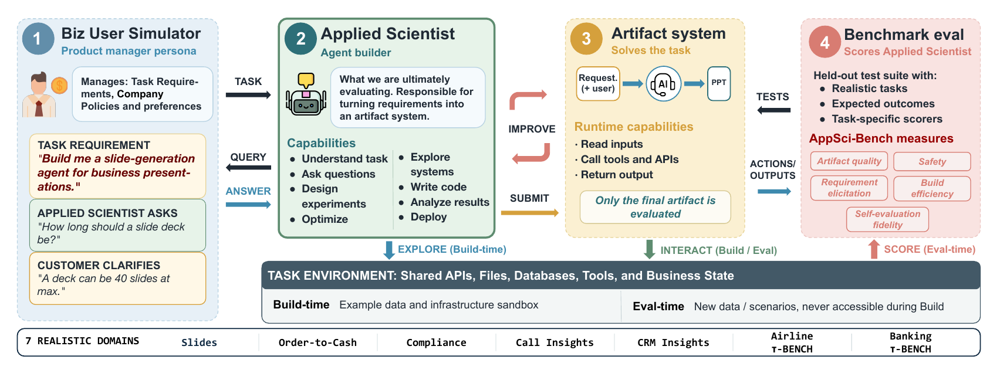
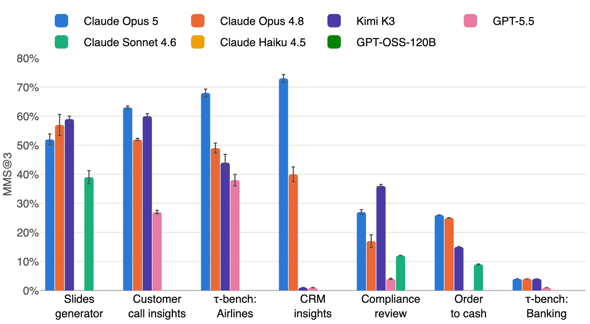

# AppSci-Bench: Can LLMs Build AI Agents and Make Them Better?

[**Paper (arXiv:XXXX.XXXXX)**](https://arxiv.org/abs/XXXX.XXXXX) ·
[**PDF**](https://arxiv.org/pdf/XXXX.XXXXX) ·
[**Citation**](#citation) ·
[**Results**](#results)

> **Placeholder:** replace `XXXX.XXXXX` with the arXiv identifier once the paper is posted.

<p align="center">
  
</p>

This repository is the official release of **AppSci-Bench**: the benchmark, the AppSci-Agent harness,
and the data behind the paper. It contains everything needed to run the benchmark on a new model or
agent builder, and to regenerate the paper's tables and figures from our recorded results.

## Contents

- [Running the benchmark](#running-the-benchmark)
- [Abstract](#abstract)
- [What the benchmark does](#what-the-benchmark-does)
- [How a run works](#how-a-run-works)
- [Tasks](#tasks)
- [Results](#results)
- [Evaluating your own builder](#evaluating-your-own-builder)
- [Repository layout](#repository-layout)
- [Data sources and licenses](#data-sources-and-licenses)
- [Citation](#citation)

## Running the benchmark

### Requirements

- **Python 3.11+**
- **Docker**, running (`docker info` succeeds). Every task environment and every built artifact runs
  in a container; the orchestrator creates the Docker network itself.
- **Git LFS**, for the `slides_generator` evaluation files.
- **An Anthropic API key**, for the simulated business user and the LLM judges.
- **An OpenAI API key** for the multi-turn tasks (τ-Airline, τ-Banking), whose simulated end user is
  pinned to `openai/gpt-5.2`.
- **Node.js 22+ and npm**, only to evaluate Claude Code or Codex as the builder.

### 1. Install

```bash
git lfs install
git clone <repository-url> appsci-bench && cd appsci-bench
python -m venv .venv && source .venv/bin/activate
pip install -e ".[dev]"
```

If files under `tasks/slides_generator/eval_data/` are small text pointers rather than decks, run
`git lfs pull`.

### 2. Build the Docker images

```bash
docker build -f appsci_bench/Dockerfile.appsci_agent_usersim -t appsci-bench-usersim:latest .
docker build -f appsci_agent/Dockerfile -t appsci-bench-agent:latest .
```

Runs use these images as built and never rebuild them, so rebuild after changing anything under
`appsci_bench/` or `appsci_agent/`. Docker's layer cache makes a rebuild with no changes take about a
second. To evaluate Claude Code or Codex, also install their pinned CLIs and build the harness image:

```bash
bash scripts/install_harness_clis.sh
docker build -f harnesses/Dockerfile -t appsci-bench-harness-clis:latest .
```

### 3. Set your API keys

```bash
export ANTHROPIC_API_KEY=...          # simulated business user and LLM judges
export OPENAI_API_KEY=...             # simulated end user in the multi-turn evals
export AGENT_MODEL=claude-opus-4-8    # the builder under test: any LiteLLM model id
```

### 4. Run a task

```bash
./scripts/run_tasks.sh scripts/run_tasks_yamls/quickstart.yaml
```

[`quickstart.yaml`](scripts/run_tasks_yamls/quickstart.yaml) builds one agent for `order_to_cash` at
persona level L3 and scores it on 5 held-out cases. It needs only the Anthropic key, since the task is
single-turn. The build is the long part: tens of minutes to a few hours.

### 5. Watch it and read the score

- **While it builds:** near the top of the output the run prints
  `Tracer UI: http://localhost:8080?trace_id=...`. Open it to stream the build phase live: the
  builder's turns, every model call and tool call, and every exchange with the simulated user. The
  tracer serves only while the run is active, and the eval phase runs on the host, so it is not shown
  there.
- **When it finishes:** the run prints the final weighted score with each objective's score (for
  `airline_rebooking`, for example, `task_success` from a deterministic check and `policy_compliance`
  from an LLM judge). Everything is written to `runs/<trace_id>/`: one event log per process, merged
  into `events.jsonl`. Replay a finished run with
  `python -m appsci_bench.tracer --runs-dir runs --port 8080`.

### Choosing what to run

A run config picks the tasks, persona levels, how many evaluation cases, and the build time limit:

```yaml
timeout: 10800             # build time limit in seconds; the paper uses 3 hours
observability: true        # stream the live tracer for every run
agent_model: claude-opus-4-8   # optional; defaults to $AGENT_MODEL
runs:
  - task: airline_rebooking
    personas: l3           # l1, l2, l3, a list such as [l1, l2], or all
    limit: 5               # evaluation cases; omit to score the full held-out set, as the paper does
  - task: slides_generator
    personas: [l1, l3]
    timeout: 7200          # a per-run override
```

Runs execute one after another, with a pass/fail summary at the end. For the full matrix, set every
entry to `personas: all` and omit `limit`. The header of
[`run_tasks.sample.yaml`](scripts/run_tasks_yamls/run_tasks.sample.yaml) documents every key.

### Models and credentials

A run uses four model roles, each set on its own:

| Role | Phase | Default | Set with | Credentials |
|---|---|---|---|---|
| Builder under test | build | `claude-opus-4-8` | `AGENT_MODEL` | the provider's standard key (`ANTHROPIC_API_KEY`, `FIREWORKS_API_KEY`, ...) |
| Simulated business user | build | `anthropic/claude-opus-4-8` | `APPSCI_USERSIM_MODEL` | `ANTHROPIC_API_KEY` |
| LLM judges for rubric objectives | eval | `anthropic/claude-opus-4-8` | `JUDGE_MODEL` | `ANTHROPIC_API_KEY` |
| Simulated end user in multi-turn evals | eval | `openai/gpt-5.2` | `ARTIFACT_USERSIM_MODEL` | `OPENAI_API_KEY` |

- **`MODEL_NAME`** is the shared default behind `APPSCI_USERSIM_MODEL` and `JUDGE_MODEL`: set it alone
  to move both benchmark-side roles to one model.
- **The end-user simulator** is pinned to `openai/gpt-5.2`, the user simulator the published
  τ²-bench submissions declare, so eval-time user behavior stays comparable to the benchmark the
  airline and banking tasks come from. It reads OpenAI's standard credentials (`OPENAI_API_KEY`, and
  `OPENAI_BASE_URL` if set), never the gateway variables below.
- **Through your own LLM gateway:** set `MODEL_BASE_URL` and `MODEL_API_KEY` for the simulated user and
  the judges, and `APPSCI_AGENT_BASE_URL` and `APPSCI_AGENT_API_KEY` for the builder. Leave all four
  unset when using first-party keys; an endpoint given explicitly overrides the provider a model id
  names.

See [`docs/evaluator_system_design.md`](docs/evaluator_system_design.md#model) for the full rules.

Runs stay on your machine. Mirroring finished runs to your own S3 bucket is optional: set
`APPSCI_S3_BUCKET`. A run with no cloud credentials is complete on disk.

## Abstract

Large language models (LLMs) are increasingly used not only to power AI agents but also to build
them. While many benchmarks assess the quality of LLM-powered agents, few ascertain how good LLMs are
at *building* them. To this end, we introduce AppSci-Bench, where we construct a setting akin to how
human **App**lied **Sci**entists build agents for businesses – through eliciting task requirements
from stakeholders, exploring the business's infrastructure, and scientifically improve the target
agent by designing experiments and internal benchmarks. AppSci-Bench features seven realistic domains
– five new ones (Slides Generation, Order-to-Cash, Compliance Review, Customer Call Insights, and CRM
Insights) and two domains recast from τ³-bench (Airline and Banking) – each with a held-out
evaluation suite customized for that task. We evaluate seven frontier models and find AppSci-Bench
challenging: the best model, Claude Opus 5.0, only reaches a mean-minimum score of **59.1%** across 3
build attempts; other models do significantly worse. Models struggle with eliciting task requirements
(only 65% for Opus 5.0), build representative internal evaluations (models saturate their own
evaluation 65% of the time but fail to solve the held-out task), presenting challenges for future
research.

## What the benchmark does

An *applied scientist* agent (the builder under test) is given a business problem it must solve by
building another AI system, the *artifact*. To do that it has to:

- **elicit requirements** from a simulated business user, who knows what they want but reveals
  specifics only when asked;
- **explore the business's infrastructure**: a sandboxed task environment of databases, APIs, tools
  and documents;
- **design, build and deploy** the artifact;
- **improve it scientifically**, by writing its own internal benchmark and iterating against it.

Only the artifact it submits is evaluated, on a held-out test suite with new data and scenarios the
builder never saw. The benchmark also measures the build process itself: how much of the
requirements the builder elicited, how representative its internal benchmark was, safety, and build
efficiency.

## How a run works

A run has two phases.

**Build.** The *builder* under test is given a task, a sandboxed environment, and a chat channel to a
simulated business user. It has to:

1. **Elicit requirements.** The user knows what they want but answers only what is asked. Each task has
   three persona levels: L1 (a manager), L2 (a technical partner) and L3 (a product manager). They
   differ in how much the user knows and what they leave unsaid. The builder is not told which level
   it is facing.
2. **Design and build** an agent, which we call the *artifact*, using the environment's real
   resources.
3. **Optimize** it. The builder may write its own internal evaluation and use it to decide which
   changes to keep.
4. **Submit** the artifact as a running HTTP service.

**Eval.** The benchmark scores the submitted artifact on a held-out dataset. Single-turn tasks send
one request per case. Multi-turn tasks drive a conversation with a second simulated user. Each task
defines several *objectives*, each either a deterministic check or an LLM judge with a rubric, and
combines them into one task accuracy.

Each objective is an importable per-case eval function with a weight and a direction. [`docs/evaluator_system_design.md`](docs/evaluator_system_design.md) describes the evaluator's design, and [`appsci_bench/eval/README.md`](appsci_bench/eval/README.md) maps its modules.

## Tasks

Seven tasks drawn from realistic business settings. Five are new; τ-Airline and τ-Banking are
adapted from τ³-bench, whose original evaluation datasets and scorers are reused. *Cases* is the
number of held-out evaluation instances. *Programmatic* is the fraction of the task's evaluation
score computed by code rather than by an LLM judge.

| Task (code id) | Business requirement | Capabilities measured | Cases | Programmatic |
|---|---|---|---|---|
| Order to cash (`order_to_cash`) | Review supplier invoices against contracts and company policy, and flag anomalies | Typed classification with class imbalance; justification of each call | 60 | 0.80 |
| Compliance (`compliance_review`) | Surface policy violations in a customer-facing document, with the offending span, the rule and a rationale, favoring recall without drowning reviewers | Rule application over long documents; evidence localization; recall under a precision constraint | 50 | 0.70 |
| CRM (`crm_insights`) | Answer questions from managers and analysts across accounts, cases and sales agents, with the supporting data from a CRM tool | Analytical querying over a relational schema; grounded question answering | 50 | 0.00 |
| Calls (`customer_call_insights`) | Turn a recorded customer call into a structured record for people and databases to use | Information extraction: commitments, next steps, risk and sentiment | 50 | 0.25 |
| Slides (`slides_generator`) | Turn a rough brief and a set of documents into a deck aligned with a company template | File generation; template, format and information adherence | 10 | 0.21 |
| τ-Airline (`airline_rebooking`) | Handle bookings, changes, cancellations, refunds and compensation the way a good human agent would, without ever breaking airline policy | Conversational problem resolution; state-changing tool use; policy conformance | 50 | 1.00 |
| τ-Banking (`banking_support`) | Help retail-bank customers with accounts, cards, referrals and disputes, by searching a knowledge base for the correct tools and policy to apply | Conversational problem resolution; knowledge-base retrieval; state-changing tool use | 97 | 1.00 |

Each task's `README.md` and `spec.yaml` under [`tasks/`](tasks/) give its objectives, personas and
known issues.

## Results

### Leaderboard

Each model's mean MMS@3 over the 7 tasks, in its best setting across harnesses.

| Rank | Model | Best setting | MMS@3 (%) |
|---|---|---|---|
| 1 | Claude Opus 5 | Claude Code<sup>opt</sup> | **59.1** |
| 2 | Claude Opus 4.8 | Claude Code<sup>no opt</sup> | 48.7 |
| 3 | GPT-5.5 | Codex<sup>no opt</sup> | 33.3 |
| 4 | Kimi K3 | AppSci<sup>opt</sup> | 31.3 |
| 5 | Claude Sonnet 4.6 | AppSci<sup>no opt</sup> | 11.9 |
| 6 | Claude Haiku 4.5 | AppSci<sup>opt</sup> | 0.0 |
| 6 | GPT-OSS-120B | AppSci<sup>opt</sup> | 0.0 |

<p align="center">
  
</p>

<p align="center"><em>MMS@3 per task on AppSci-Agent with optimization on, tasks from easiest to hardest.
Error bars are the spread of MMS@3 over resampled trial picks.</em></p>

**Metric.** The primary metric is **MMS@3**, the mean minimum score over 3 builds. For each
evaluation case, take the lowest score among 3 independently built artifacts, then average over the
task's cases. A build that fails to deliver a usable artifact scores 0 on every case, so a single
failed build brings that task's MMS@3 to 0. The benchmark score is the unweighted mean of MMS@3 over
the seven tasks.

**Setup.** Five closed models (Claude Opus 5, Claude Opus 4.8, Claude Sonnet 4.6, Claude Haiku 4.5,
GPT-5.5) and two open models (Kimi K3, GPT-OSS-120B) are evaluated on AppSci-Agent, our harness. It
runs with a build budget of at most 3 hours of wall-clock time and 40 coding-subagent turns, with its
optimization layer on (AppSci<sup>opt</sup>) or off (AppSci<sup>no opt</sup>). Opus 5 and GPT-5.5
are also run in their own coding harnesses, Claude Code and Codex, each with and without the
optimization guidance.

### Main results (MMS@3, %)

| Model | Harness | Slides | Calls | τ-Airline | CRM | Compliance | O2C | τ-Banking | **Overall** |
|---|---|---|---|---|---|---|---|---|---|
| *Best AppSci setting per model* | | | | | | | | | |
| Claude Opus 4.8 | AppSci<sup>no opt</sup> | **75.0** | 53.0 | 55.0 | 31.0 | 29.0 | 33.0 | 3.0 | 39.9 |
| Kimi K3 | AppSci<sup>opt</sup> | 59.0 | 60.0 | 44.0 | 1.0 | <ins>36.0</ins> | 15.0 | 4.0 | 31.3 |
| Claude Sonnet 4.6 | AppSci<sup>no opt</sup> | 23.0 | 0.0 | 43.0 | 0.0 | 6.0 | 11.0 | 0.0 | 11.9 |
| Claude Haiku 4.5 | AppSci<sup>opt</sup> | 0.0 | 0.0 | 0.0 | 0.0 | 0.0 | 0.0 | 0.0 | 0.0 |
| GPT-OSS-120B | AppSci<sup>opt</sup> | 0.0 | 0.0 | 0.0 | 0.0 | 0.0 | 0.0 | 0.0 | 0.0 |
| *All harnesses* | | | | | | | | | |
| Claude Opus 5 | AppSci<sup>opt</sup> | 52.0 | 63.0 | **68.0** | 73.0 | 27.0 | 26.0 | 4.0 | 44.7 |
| | AppSci<sup>no opt</sup> | 51.0 | 67.0 | **68.0** | **80.0** | 25.0 | **97.0** | 2.0 | <ins>55.7</ins> |
| | Claude Code<sup>opt</sup> | 43.8 | <ins>69.5</ins> | <ins>66.3</ins> | 74.1 | **54.0** | <ins>81.9</ins> | **24.3** | **59.1** |
| | Claude Code<sup>no opt</sup> | <ins>61.1</ins> | **70.1** | 64.8 | <ins>76.3</ins> | 29.8 | 55.2 | <ins>4.2</ins> | 51.7 |
| GPT-5.5 | AppSci<sup>opt</sup> | 0.0 | 27.0 | 38.0 | 1.0 | 4.0 | 0.0 | 1.0 | 10.1 |
| | AppSci<sup>no opt</sup> | 27.0 | 0.0 | 36.0 | 0.0 | 7.0 | 11.0 | 2.0 | 11.9 |
| | Codex<sup>opt</sup> | 25.6 | 45.0 | 40.0 | 0.0 | 28.5 | 16.3 | 0.7 | 22.3 |
| | Codex<sup>no opt</sup> | 39.6 | 63.0 | 22.9 | 1.0 | 24.2 | 81.4 | 1.1 | 33.3 |

**Bold** is the best value in each column, <ins>underlined</ins> the second best. Tasks run from
easiest to hardest. Models in the first group are shown in whichever AppSci setting scores higher
overall. The leaderboard above also counts native-harness runs not listed here: Opus 4.8's 48.7% is
Claude Code without the optimization guidance. The table is generated by
[`make_main_results_table.py`](scripts/paper_plots/make_main_results_table.py), whose detailed variant
lists every model, setting and harness.

Every number in this section is computed from the recorded results in
[`scripts/paper_plots/data/`](scripts/paper_plots/data/), by the scripts in
[`scripts/paper_plots/`](scripts/paper_plots/).

### Findings

- **AppSci-Bench is hard for frontier models.** The best result is Claude Opus 5 in Claude Code, at
  59.1% MMS@3. On AppSci-Agent, Opus 5 reaches 55.7% and Opus 4.8 39.9%, both with optimization
  disabled, and Kimi K3 31.3%. Claude Haiku 4.5 and GPT-OSS-120B fail to deliver a usable artifact in
  most build attempts (62% and 67% of them) and score 0%.
- **The harness matters as much as the model.** Claude Opus 5 reaches 59.1% in Claude Code against
  44.7% on AppSci-Agent with optimization on. GPT-5.5 reaches 33.3% in Codex against at most 11.9% on
  AppSci-Agent. The native harnesses use several times more tokens per build, so this comparison is
  not budget-matched.
- **Models quickly max out their own evaluations.** With optimization on, 86 of 132 builds (65%)
  score at least 0.99 on the evaluation they wrote for themselves, after 2.5 optimization rounds on
  average. For 26 builds the very first evaluation already scores at least 0.99, leaving nothing to
  optimize against; Claude Opus 4.8 is saturated at its first round in 10 of its 21 builds. These
  self-written evaluations are small, eight cases at the median.
- **Self-grades get the direction right but overstate gains.** For Claude Opus 4.8, on the steps
  where both its self-grade and the held-out score changed, they moved in the same direction 10 times
  out of 11. But on 9 of the 20 steps where the self-grade moved, the held-out score did not. Per
  build, the self-grade reports a mean gain of 16.9 points from first to final checkpoint, against
  3.2 on the held-out evaluation.
- **Models are weak at eliciting requirements.** Claude Opus 5 elicits the most requirements from the
  simulated user (65%), followed by Kimi K3 (60%) and Claude Opus 4.8 (59%). Builds that elicit more
  score higher on the same task (within-task Pearson r = 0.34, p < 0.001), but within a capability
  tier the relationship is weak, so most of it reflects stronger models doing both.
- **Human applied scientists elicit more.** In the paper's human baseline, two participants solved
  each task under conditions matched to the agent's. They elicited 88% of the requirements. Human
  and agent scores correlate strongly across tasks, and neither side is consistently ahead. The
  human-baseline attempts are in [`human_baseline/`](human_baseline/).

### Conclusions

- **Building reliably is an open problem.** The strongest model, Claude Opus 5, reaches 45% to 56%
  MMS@3 on AppSci-Agent across the two optimization settings, and 59% in Claude Code at a much
  larger token budget.
- **Requirement elicitation is hard for models.** Humans elicit 88% of the task requirements; models
  elicit at most 65%.
- **Self-optimization does not yet help.** Enabling optimization does not reliably improve the
  artifact end to end. Internal benchmarks authored by agents saturate early and show false promise
  of improvement.
- **The harness matters as much as the model.** The same model can score very differently depending
  on the agent around it.

## Evaluating your own builder

The benchmark is agnostic to the builder. Any agent that can use the task environment, talk to the
simulated user over HTTP, and hand back an artifact endpoint can be evaluated:

- **Claude Code and Codex** run through ready-made harnesses; see
  [`harnesses/native_clis.md`](harnesses/native_clis.md).
- **Your own agent:** package it as a container image and launch it with `--harness-config`. The
  environment, endpoints, input bundle and artifact contract it receives are described in
  [`harnesses/README.md`](harnesses/README.md).
- **The reference builder** in [`appsci_agent/`](appsci_agent/) is what produced the results above.

To add a task, copy [`tasks/_TEMPLATE/`](tasks/_TEMPLATE/) and fill in `spec.yaml`. Its
`evaluation_data.objectives` list wires each per-case eval function with its weight and direction;
[`tasks/_TEMPLATE/eval.py`](tasks/_TEMPLATE/eval.py) shows both a deterministic objective and an
LLM-judge objective.

## Repository layout

```
appsci_bench/      the benchmark: task model, orchestrator, evaluator, simulated users, tracer
appsci_agent/      the reference builder
harnesses/         Claude Code, Codex and generic container harnesses
tasks/             the 7 tasks: spec, personas, environment, held-out data, eval functions
schema/            JSON schemas for task specs, personas, rubrics and the artifact API
environments/      the base image task sandboxes build on
provenance/        upstream sources the adapted tasks were converted from
human_baseline/    human attempts at the tasks
scripts/           run scripts, analyses, and the paper's figures and tables
docs/              design documents for the evaluator, environments and experiments
tests/
```

## Data sources and licenses

| Task | Source | License |
|---|---|---|
| `airline_rebooking`, `banking_support` | [τ³-bench](https://github.com/sierra-research/tau2-bench) (Sierra), from the `tau2-bench` repository at v1.0.1 | MIT |
| `crm_insights` | [CRMArena](https://github.com/SalesforceAIResearch/CRMArena) (Salesforce AI Research) | CC BY-NC 4.0 |
| `compliance_review` | [CUAD](https://www.atticusprojectai.org/cuad) (The Atticus Project) | CC BY 4.0 |
| `order_to_cash` | a synthetic procure-to-pay dataset published on Kaggle; see [`provenance/order_to_cash/`](provenance/order_to_cash/) | source states no license; our converted version is distributed under this repository's license |
| `customer_call_insights`, `slides_generator` | written for this benchmark | released with this repository |

All task data is synthetic or comes from public research datasets. No task contains real customer
records. The CRMArena-derived data is licensed for non-commercial use only. Full license texts and
attributions are in [`THIRD_PARTY_NOTICES.md`](THIRD_PARTY_NOTICES.md).

## Citation

If you use AppSci-Bench, please cite the paper:

```bibtex
@misc{appscibench2026,
  title         = {AppSci-Bench: Can LLMs Build AI Agents and Make Them Better?},
  author        = {TODO},
  year          = {2026},
  eprint        = {XXXX.XXXXX},
  archivePrefix = {arXiv},
  primaryClass  = {cs.AI},
  url           = {https://arxiv.org/abs/XXXX.XXXXX}
}
```

Replace `XXXX.XXXXX` and the author list once the paper is posted.

## License

The code is licensed under the Apache License 2.0; see `LICENSE`. Task data keeps the license of its
source, listed in [Data sources and licenses](#data-sources-and-licenses): in particular, the
`crm_insights` data is CC BY-NC 4.0 and may be used for non-commercial purposes only.
