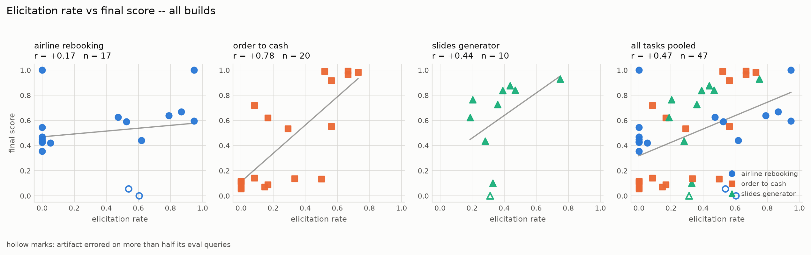
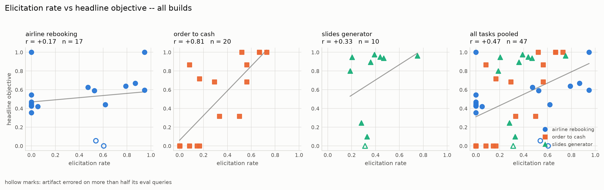
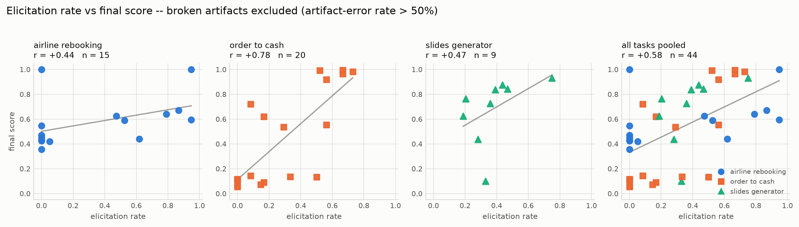
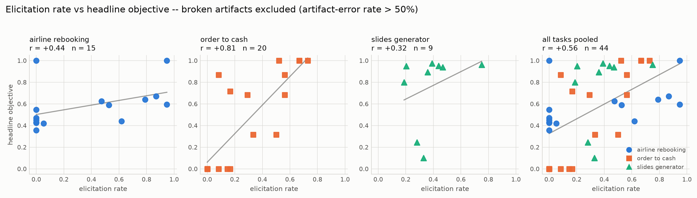
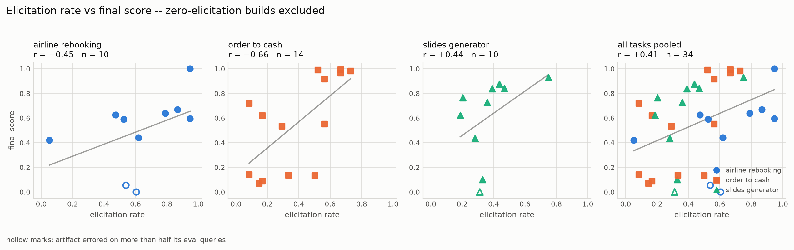
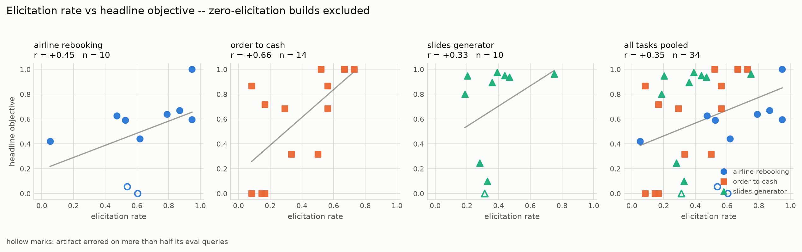
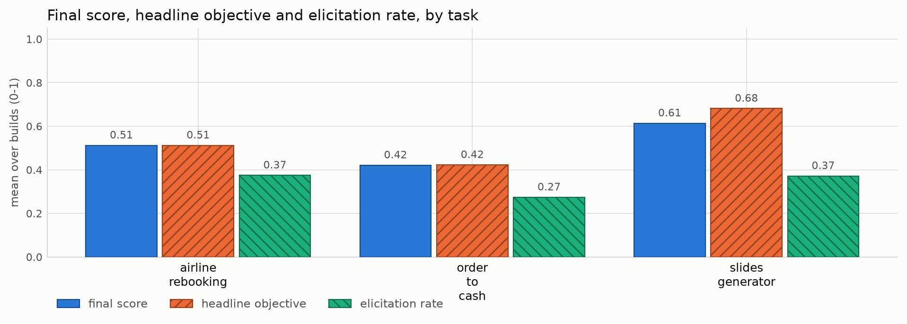

# Elicitation quality vs task performance

2026-09-04 22:52 UTC, code at commit `e028be4a`. Source: the shared S3 run mirror (`s3://<your-bucket>/runs/`). Fetched reports are cached on disk and re-read only when the analysis is run with `--refresh`, so a run re-scored in the mirror since the first sweep is represented here by its earlier numbers until then.

## Variables

Two measurements per build.

**Elicitation rate** (`x`). Of the rubric items only the simulated stakeholder held, the proportion the agent obtained by asking. Items satisfiable from anything mounted into the agent's container are excluded by construction, so this measures elicitation rather than retrieval.

A rate of exactly 0.000 is a true zero rather than a missing measurement, and it arises two ways: `no_exchanges`, where the agent never contacted the stakeholder at all (12 builds), and `scored`, where it did make contact and obtained none of the rubric's items (1 build). 13 of 47 builds sit there. A run whose rate could not be measured is excluded rather than scored as zero -- see the exclusion census.

**Task score** (`y`), reported in two forms. The **final score** is the weighted mean over every objective the task declares. The **headline objective** is the single highest-weighted objective, reported separately because the blended figure can mask movement in the objective a task actually exists to measure.

## Statistical conventions

**Unit of analysis: the build** -- one stakeholder conversation and the single artifact produced from it. Each build's eval trials are averaged into one observation. Trials are repeated measures of the same artifact against the same conversation (observed within-build score SD 0.002 to 0.04, against 0.2+ between builds), so treating them as independent would inflate `n` roughly fourfold and understate every interval.

**Pearson r** is the product-moment correlation; **Spearman rho** is the same statistic on ranks and is reported alongside as a robustness check. A material gap between them indicates leverage from one or two observations.

**95% CI (bootstrap)** is a percentile interval over 10,000 resamples of builds. Where a row is centered, the group means are re-derived inside each resample rather than carried in from the full sample: a mean estimated from the same data is not a known constant, and treating it as one narrows the interval below what the evidence supports. An interval spanning zero means the data do not exclude a null association.

**Permutation p** is two-sided, from 10,000 random reassignments of `y` against `x`. Where a row is centered, the reassignment is restricted to within each group, which is the null that matches a within-group estimator; shuffling deviations across groups tests an easier one. Simulated rather than taken from the t-approximation, whose distributional assumptions are weak at the smallest per-task counts here (n = 9 to 10).

**n_eff, informative groups, x-var retained** qualify the centered rows, because `n` alone overstates them. Estimating a group mean costs one degree of freedom, which `n_eff` reflects. A group holding a single build contributes a deviation of exactly zero on both axes, and so does a group whose builds all share one elicitation rate, so **informative groups** counts those that can move the estimate at all. **x-var retained** is the share of the raw spread in elicitation that survives the centering: near 100% means the scheme absorbed almost nothing and the row nearly restates the uncentered one, while a small share means a much harder question asked of much less data.

## Group-mean centering

The first row of each pooled table is the uncentered correlation over all builds. It is also the row most vulnerable to confounding, because builds differ along two dimensions besides elicitation.

**Task.** Score distributions differ by task for reasons unrelated to any agent -- different objectives, different weights, different difficulty. If the task with the more generous score distribution is also the task where elicitation is easier, the pooled correlation partly reflects that coincidence rather than any within-task relationship.

**Model.** Capability is common to both variables. A stronger model elicits better and builds better, and both measurements come from the same agent in the same run, so general capability is a shared cause that produces a positive correlation with elicitation on no causal path at all.

Group-mean centering (equivalently, demeaning, or absorbing a fixed effect for the grouping) removes one of those dimensions. Each group's own mean is subtracted from both variables, so an observation is expressed as its deviation from its group rather than as its raw value, and the correlation is computed on those deviations. Only within-group covariation remains.

The intuition, if it helps: to test whether study time raises exam marks using students drawn from schools that mark to different standards, the pooled correlation can be driven by "the school that marks generously also sets more homework". Subtracting each school's mean from both variables recovers the intended question -- does a student who studies more than their school's average also score above their school's average?

The four rows apply that at three levels:

| centering | question it answers |
|---|---|
| pooled (uncentered) | Across the whole corpus, do builds with a higher elicitation rate score higher? |
| within-task centered | Within a single task, do builds with a higher elicitation rate score higher? |
| within-model centered | Within a single model, do its higher-elicitation builds score higher? |
| within task x model centered | With task and model both absorbed, does build-to-build variation in elicitation track build-to-build variation in artifact quality? |

Each row absorbs one further confound and leaves less residual variance to work with, so the estimates fall in magnitude and rise in standard error together.

**The last row is underpowered and must not be read as a null.** It exists because the models were not run evenly across tasks -- so within-model centering still leaves task composition in, and this is the only row that removes both -- and because it asks the operationally useful question: if the same model runs the same task again and elicits more, is the artifact better? But its cells hold about three builds each, several contribute nothing, and its interval spans roughly -0.45 to +0.58. It cannot distinguish a moderate positive association from a moderate negative one, so a coefficient near zero there is an absence of evidence and not evidence of absence.

**The row that bears on construct validity -- whether elicitation is a capability or an artefact of the metric -- is within-model centered.** If the association survives absorbing the model, elicitation carries information not already supplied by general capability. If it collapses, the pooled coefficient largely restates the model ranking.

**Centering applies to the tables only. Every scatter plots raw values**, both axes on the 0-1 scale, so a point can be read off as that build's actual elicitation rate and actual score. The `r` printed on each panel is the uncentered coefficient for the points shown, and the line is the least-squares fit through them.

## Sample and exclusions

A zero means the criterion was applied and matched no runs.

| exclusion criterion | runs |
|---|---|
| no eval report | 316 |
| not a replicate trial (no attributable model) | 79 |
| eval report present but no elicitation score in it | 0 |
| eval report unreadable | 0 |
| no paired elicitation rate and score | 0 |
| pre-carve, by commit ancestry | 0 |
| pre-carve, by merge-date comparison (no commit recorded) | 0 |
| pre-carve, by no carve recorded for this task (unchecked) | 0 |

**all builds**: n = 47 builds over 177 eval trials. By task: airline_rebooking 17, order_to_cash 20, slides_generator 10. By model: claude-haiku-4-5 7, claude-opus-4-8 13, claude-sonnet-4-6 12, gpt-5.1 3, gpt-5.5 3, kimi-k3 9.

**broken artifacts excluded (artifact-error rate > 50%)**: n = 44 builds over 167 eval trials. By task: airline_rebooking 15, order_to_cash 20, slides_generator 9. By model: claude-haiku-4-5 5, claude-opus-4-8 12, claude-sonnet-4-6 12, gpt-5.1 3, gpt-5.5 3, kimi-k3 9.

**zero-elicitation builds excluded**: n = 34 builds over 127 eval trials. By task: airline_rebooking 10, order_to_cash 14, slides_generator 10. By model: claude-haiku-4-5 6, claude-opus-4-8 11, claude-sonnet-4-6 3, gpt-5.1 3, gpt-5.5 2, kimi-k3 9.

The second sample excludes builds whose artifact-error rate exceeds 50%. Those errors are the artifact returning HTTP 5xx/4xx under query: it built, deployed and is reachable, and fails on use. That is artifact quality, so such builds remain in the primary sample. Builds that produced no artifact at all have no score and enter neither sample.

The third sample excludes every build at an elicitation rate of exactly zero -- 13 of 47, of which 12 never contacted the stakeholder and 1 made contact and obtained nothing. They are a quarter of the corpus and they score well below the rest, so without this cut a reader cannot tell how much of the association is the narrower claim that an agent which talks at all does better than one which does not. They belong in the primary sample -- never contacting the stakeholder is a real elicitation outcome, not a failed measurement -- and the cut is here so the two claims can be separated.

### Gating filter: post-carve runs only

Each task was carved at some point: material formerly readable from the agent's own container was moved behind the stakeholder simulator. Pre-carve runs are excluded, because an agent that could read the rubric's facts had no reason to elicit them, making the rate a property of the setup rather than of the agent. Inclusion is decided by commit ancestry -- whether the commit a run was submitted from already contained that task's carve commit -- falling back to a merge-date comparison for runs with no recorded commit, which is approximate at the boundary.

Basis: 133 trials by commit ancestry, 44 trials by merge-date comparison (no commit recorded). Carve commit per task: airline_rebooking at `9c0a1f91`, 2026-08-19; order_to_cash at `4ccf6e2a`, 2026-08-28; slides_generator at `0190398d`, 2026-08-25.

### Judge reliability

The elicitation rate is assigned by an LLM judge, and each of a build's trials re-scores the same conversation independently, so the trials constitute free replicate measurements of judge reliability. Mean within-build SD is 0.015, max 0.068 on the 0-1 scale, over 46 builds with more than one trial. Averaging trials into one observation per build removes most of it. Residual measurement error in `x` attenuates the correlations below toward zero rather than inflating them, so the reported coefficients are conservative with respect to this source.

## Results

### All builds

#### y = final score

By task, one observation per build:

| task | n | Pearson r | 95% CI (bootstrap) | permutation p | Spearman rho |
|---|---|---|---|---|---|
| airline_rebooking | 17 | +0.168 | [-0.33, +0.73] | 0.531 | +0.326 |
| order_to_cash | 20 | +0.785 | [+0.52, +0.94] | 0.000 | +0.787 |
| slides_generator | 10 | +0.438 | [-0.05, +0.84] | 0.203 | +0.721 |

Pooled over tasks, under the four centering schemes defined above:

| centering | n | n_eff | informative groups | x-var retained | Pearson r | 95% CI (bootstrap) | permutation p | Spearman rho |
|---|---|---|---|---|---|---|---|---|
| pooled (uncentered) | 47 | 47 | -- | -- | +0.474 | [+0.24, +0.67] | 0.001 | +0.470 |
| within-task centered | 47 | 44 | 3 of 3 | 97% | +0.460 | [+0.20, +0.68] | 0.001 | +0.445 |
| within-model centered | 47 | 41 | 6 of 6 | 55% | +0.213 | [-0.09, +0.51] | 0.190 | +0.242 |
| within task x model centered | 47 | 32 | 11 of 15 | 43% | +0.025 | [-0.45, +0.58] | 0.940 | +0.260 |

#### y = headline objective

By task, one observation per build:

| task | n | Pearson r | 95% CI (bootstrap) | permutation p | Spearman rho |
|---|---|---|---|---|---|
| airline_rebooking | 17 | +0.168 | [-0.33, +0.74] | 0.516 | +0.326 |
| order_to_cash | 20 | +0.813 | [+0.58, +0.96] | 0.000 | +0.846 |
| slides_generator | 10 | +0.330 | [-0.13, +0.81] | 0.368 | +0.564 |

Pooled over tasks, under the four centering schemes defined above:

| centering | n | n_eff | informative groups | x-var retained | Pearson r | 95% CI (bootstrap) | permutation p | Spearman rho |
|---|---|---|---|---|---|---|---|---|
| pooled (uncentered) | 47 | 47 | -- | -- | +0.472 | [+0.26, +0.66] | 0.001 | +0.501 |
| within-task centered | 47 | 44 | 3 of 3 | 97% | +0.461 | [+0.22, +0.66] | 0.000 | +0.418 |
| within-model centered | 47 | 41 | 6 of 6 | 55% | +0.216 | [-0.07, +0.49] | 0.156 | +0.212 |
| within task x model centered | 47 | 32 | 11 of 15 | 43% | +0.016 | [-0.42, +0.57] | 0.955 | +0.210 |

### Broken artifacts excluded (artifact-error rate > 50%)

#### y = final score

By task, one observation per build:

| task | n | Pearson r | 95% CI (bootstrap) | permutation p | Spearman rho |
|---|---|---|---|---|---|
| airline_rebooking | 15 | +0.441 | [-0.09, +0.89] | 0.103 | +0.537 |
| order_to_cash | 20 | +0.785 | [+0.51, +0.94] | 0.000 | +0.787 |
| slides_generator | 9 | +0.471 | [+0.04, +0.90] | 0.204 | +0.783 |

Pooled over tasks, under the four centering schemes defined above:

| centering | n | n_eff | informative groups | x-var retained | Pearson r | 95% CI (bootstrap) | permutation p | Spearman rho |
|---|---|---|---|---|---|---|---|---|
| pooled (uncentered) | 44 | 44 | -- | -- | +0.576 | [+0.37, +0.75] | 0.000 | +0.606 |
| within-task centered | 44 | 41 | 3 of 3 | 98% | +0.566 | [+0.34, +0.75] | 0.000 | +0.528 |
| within-model centered | 44 | 38 | 6 of 6 | 55% | +0.285 | [-0.05, +0.58] | 0.054 | +0.238 |
| within task x model centered | 44 | 30 | 11 of 14 | 43% | +0.133 | [-0.43, +0.67] | 0.574 | +0.245 |

#### y = headline objective

By task, one observation per build:

| task | n | Pearson r | 95% CI (bootstrap) | permutation p | Spearman rho |
|---|---|---|---|---|---|
| airline_rebooking | 15 | +0.441 | [-0.09, +0.89] | 0.099 | +0.537 |
| order_to_cash | 20 | +0.813 | [+0.57, +0.96] | 0.000 | +0.846 |
| slides_generator | 9 | +0.318 | [-0.07, +0.80] | 0.395 | +0.583 |

Pooled over tasks, under the four centering schemes defined above:

| centering | n | n_eff | informative groups | x-var retained | Pearson r | 95% CI (bootstrap) | permutation p | Spearman rho |
|---|---|---|---|---|---|---|---|---|
| pooled (uncentered) | 44 | 44 | -- | -- | +0.561 | [+0.36, +0.72] | 0.000 | +0.586 |
| within-task centered | 44 | 41 | 3 of 3 | 98% | +0.553 | [+0.34, +0.73] | 0.000 | +0.547 |
| within-model centered | 44 | 38 | 6 of 6 | 55% | +0.270 | [-0.05, +0.55] | 0.055 | +0.229 |
| within task x model centered | 44 | 30 | 11 of 14 | 43% | +0.108 | [-0.37, +0.66] | 0.583 | +0.183 |

### Zero-elicitation builds excluded

#### y = final score

By task, one observation per build:

| task | n | Pearson r | 95% CI (bootstrap) | permutation p | Spearman rho |
|---|---|---|---|---|---|
| airline_rebooking | 10 | +0.446 | [+0.02, +0.86] | 0.196 | +0.565 |
| order_to_cash | 14 | +0.657 | [+0.26, +0.91] | 0.015 | +0.642 |
| slides_generator | 10 | +0.438 | [-0.03, +0.85] | 0.206 | +0.721 |

Pooled over tasks, under the four centering schemes defined above:

| centering | n | n_eff | informative groups | x-var retained | Pearson r | 95% CI (bootstrap) | permutation p | Spearman rho |
|---|---|---|---|---|---|---|---|---|
| pooled (uncentered) | 34 | 34 | -- | -- | +0.414 | [+0.16, +0.63] | 0.016 | +0.435 |
| within-task centered | 34 | 31 | 3 of 3 | 78% | +0.534 | [+0.30, +0.74] | 0.002 | +0.598 |
| within-model centered | 34 | 28 | 6 of 6 | 53% | +0.179 | [-0.14, +0.45] | 0.362 | +0.164 |
| within task x model centered | 34 | 21 | 10 of 13 | 30% | +0.449 | [-0.01, +0.73] | 0.014 | +0.599 |

#### y = headline objective

By task, one observation per build:

| task | n | Pearson r | 95% CI (bootstrap) | permutation p | Spearman rho |
|---|---|---|---|---|---|
| airline_rebooking | 10 | +0.446 | [+0.04, +0.86] | 0.191 | +0.565 |
| order_to_cash | 14 | +0.662 | [+0.26, +0.94] | 0.014 | +0.699 |
| slides_generator | 10 | +0.330 | [-0.12, +0.80] | 0.358 | +0.564 |

Pooled over tasks, under the four centering schemes defined above:

| centering | n | n_eff | informative groups | x-var retained | Pearson r | 95% CI (bootstrap) | permutation p | Spearman rho |
|---|---|---|---|---|---|---|---|---|
| pooled (uncentered) | 34 | 34 | -- | -- | +0.354 | [+0.06, +0.60] | 0.040 | +0.379 |
| within-task centered | 34 | 31 | 3 of 3 | 78% | +0.502 | [+0.26, +0.72] | 0.002 | +0.582 |
| within-model centered | 34 | 28 | 6 of 6 | 53% | +0.119 | [-0.23, +0.43] | 0.555 | +0.069 |
| within task x model centered | 34 | 21 | 10 of 13 | 30% | +0.398 | [-0.01, +0.76] | 0.019 | +0.517 |

## Per-task means

| task | builds | final score | headline objective | elicitation rate | rubric items judged |
|---|---|---|---|---|---|
| airline_rebooking | 17 | 0.512 | 0.512 | 0.375 | 19 |
| order_to_cash | 20 | 0.421 | 0.422 | 0.274 | 12 |
| slides_generator | 10 | 0.614 | 0.681 | 0.372 | 16 |

Two caveats when reading across. Airline's final score and headline objective are identical by construction, not coincidence: `task_success` carries the entire weight and `policy_compliance` is weighted zero. And the rubrics differ in size, so an elicitation rate over 12 judged items is quantised in steps of 0.083 against 0.053 for 19 items.

## Per-build data

One row per build. **Persona** is the stakeholder's disclosure level, L1 (most guarded) to L3 (most forthcoming); the corpus is almost entirely L3. **Within-build SD** is the spread of the elicitation rate across that build's trials, i.e. judge variance rather than agent behaviour. **Artifact-error rate** is the fraction of eval results that errored under query.

| task | model | persona | build | date | trials | elicitation rate | within-build SD | final score | headline objective | errored results | artifact-error rate |
|---|---|---|---|---|---|---|---|---|---|---|---|
| airline_rebooking | claude-haiku-4-5 | l3 | b0 | 2026-09-01 | 4 | 0.539 | 0.026 | 0.055 | 0.055 | 356/400 | 0.89 |
| airline_rebooking | claude-haiku-4-5 | l3 | b0 | 2026-09-02 | 4 | 0.618 | 0.026 | 0.440 | 0.440 | 2/400 | 0.00 |
| airline_rebooking | claude-haiku-4-5 | l3 | b1 | 2026-09-02 | 4 | 0.000 | 0.000 | 0.470 | 0.470 | 0/400 | 0.00 |
| airline_rebooking | claude-opus-4-8 | l2 | b0 | 2026-08-29 | 2 | 0.605 | 0.037 | 0.000 | 0.000 | 8/8 | 1.00 |
| airline_rebooking | claude-opus-4-8 | l2 | b0 | 2026-08-30 | 2 | 0.000 | 0.000 | 1.000 | 1.000 | 0/8 | 0.00 |
| airline_rebooking | claude-opus-4-8 | l3 | b0 | 2026-08-30 | 4 | 0.947 | 0.000 | 0.595 | 0.595 | 0/400 | 0.00 |
| airline_rebooking | claude-opus-4-8 | l2 | b1 | 2026-08-30 | 2 | 0.947 | 0.000 | 1.000 | 1.000 | 0/8 | 0.00 |
| airline_rebooking | claude-opus-4-8 | l3 | b1 | 2026-08-30 | 4 | 0.789 | 0.000 | 0.640 | 0.640 | 0/400 | 0.00 |
| airline_rebooking | claude-opus-4-8 | l3 | b2 | 2026-08-31 | 4 | 0.000 | 0.000 | 0.545 | 0.545 | 0/400 | 0.00 |
| airline_rebooking | claude-sonnet-4-6 | l3 | b2 | 2026-08-31 | 4 | 0.000 | 0.000 | 0.450 | 0.450 | 0/400 | 0.00 |
| airline_rebooking | claude-sonnet-4-6 | l3 | b0 | 2026-09-02 | 4 | 0.000 | 0.000 | 0.425 | 0.425 | 0/400 | 0.00 |
| airline_rebooking | claude-sonnet-4-6 | l3 | b1 | 2026-09-02 | 4 | 0.000 | 0.000 | 0.355 | 0.355 | 0/400 | 0.00 |
| airline_rebooking | gpt-5.5 | l3 | b0 | 2026-09-03 | 1 | 0.053 | 0.000 | 0.420 | 0.420 | 0/100 | 0.00 |
| airline_rebooking | gpt-5.5 | l3 | b2 | 2026-09-03 | 4 | 0.000 | 0.000 | 0.430 | 0.430 | 0/400 | 0.00 |
| airline_rebooking | kimi-k3 | l3 | b0 | 2026-09-02 | 4 | 0.868 | 0.030 | 0.670 | 0.670 | 4/400 | 0.00 |
| airline_rebooking | kimi-k3 | l3 | b1 | 2026-09-03 | 4 | 0.526 | 0.000 | 0.590 | 0.590 | 2/400 | 0.00 |
| airline_rebooking | kimi-k3 | l3 | b2 | 2026-09-03 | 4 | 0.474 | 0.000 | 0.625 | 0.625 | 2/400 | 0.00 |
| order_to_cash | claude-haiku-4-5 | l3 | b0 | 2026-09-01 | 4 | 0.167 | 0.000 | 0.089 | 0.000 | 0/960 | 0.00 |
| order_to_cash | claude-haiku-4-5 | l3 | b1 | 2026-09-01 | 4 | 0.500 | 0.000 | 0.134 | 0.317 | 0/960 | 0.00 |
| order_to_cash | claude-haiku-4-5 | l3 | b2 | 2026-09-01 | 4 | 0.146 | 0.042 | 0.072 | 0.000 | 0/960 | 0.00 |
| order_to_cash | claude-opus-4-8 | l3 | b0 | 2026-08-30 | 4 | 0.521 | 0.042 | 0.992 | 1.000 | 0/960 | 0.00 |
| order_to_cash | claude-opus-4-8 | l3 | b1 | 2026-08-30 | 4 | 0.562 | 0.042 | 0.918 | 0.867 | 0/960 | 0.00 |
| order_to_cash | claude-opus-4-8 | l3 | b2 | 2026-08-30 | 4 | 0.729 | 0.042 | 0.982 | 1.000 | 1/960 | 0.00 |
| order_to_cash | claude-opus-4-8 | l3 | b0 | 2026-08-31 | 2 | 0.667 | 0.000 | 0.965 | 1.000 | 0/16 | 0.00 |
| order_to_cash | claude-sonnet-4-6 | l3 | b0 | 2026-08-31 | 4 | 0.000 | 0.000 | 0.114 | 0.000 | 4/960 | 0.00 |
| order_to_cash | claude-sonnet-4-6 | l3 | b2 | 2026-08-31 | 4 | 0.000 | 0.000 | 0.055 | 0.000 | 369/960 | 0.33 |
| order_to_cash | claude-sonnet-4-6 | l3 | b0 | 2026-09-01 | 4 | 0.000 | 0.000 | 0.063 | 0.000 | 87/960 | 0.00 |
| order_to_cash | claude-sonnet-4-6 | l3 | b0 | 2026-09-02 | 4 | 0.000 | 0.000 | 0.117 | 0.000 | 1/960 | 0.00 |
| order_to_cash | claude-sonnet-4-6 | l3 | b1 | 2026-09-02 | 4 | 0.000 | 0.000 | 0.111 | 0.000 | 0/960 | 0.00 |
| order_to_cash | claude-sonnet-4-6 | l3 | b2 | 2026-09-02 | 4 | 0.000 | 0.000 | 0.106 | 0.000 | 140/960 | 0.00 |
| order_to_cash | gpt-5.1 | l3 | b0 | 2026-09-03 | 4 | 0.562 | 0.042 | 0.553 | 0.683 | 0/960 | 0.00 |
| order_to_cash | gpt-5.1 | l3 | b1 | 2026-09-03 | 4 | 0.333 | 0.000 | 0.137 | 0.317 | 0/960 | 0.00 |
| order_to_cash | gpt-5.1 | l3 | b2 | 2026-09-03 | 4 | 0.292 | 0.048 | 0.535 | 0.683 | 0/960 | 0.00 |
| order_to_cash | gpt-5.5 | l3 | b1 | 2026-09-03 | 4 | 0.083 | 0.000 | 0.143 | 0.000 | 0/960 | 0.00 |
| order_to_cash | kimi-k3 | l3 | b0 | 2026-09-02 | 4 | 0.083 | 0.000 | 0.721 | 0.867 | 0/960 | 0.00 |
| order_to_cash | kimi-k3 | l3 | b1 | 2026-09-02 | 4 | 0.167 | 0.068 | 0.620 | 0.717 | 0/960 | 0.00 |
| order_to_cash | kimi-k3 | l3 | b2 | 2026-09-02 | 4 | 0.667 | 0.000 | 0.994 | 1.000 | 1/960 | 0.00 |
| slides_generator | claude-haiku-4-5 | l3 | b2 | 2026-09-01 | 4 | 0.312 | 0.051 | 0.000 | 0.000 | 220/220 | 1.00 |
| slides_generator | claude-opus-4-8 | l3 | b0 | 2026-08-31 | 4 | 0.438 | 0.000 | 0.876 | 0.951 | 0/220 | 0.00 |
| slides_generator | claude-opus-4-8 | l3 | b1 | 2026-08-31 | 4 | 0.750 | 0.000 | 0.930 | 0.962 | 0/220 | 0.00 |
| slides_generator | claude-opus-4-8 | l3 | b2 | 2026-08-31 | 4 | 0.469 | 0.036 | 0.841 | 0.939 | 0/220 | 0.00 |
| slides_generator | claude-sonnet-4-6 | l3 | b0 | 2026-08-31 | 4 | 0.391 | 0.031 | 0.838 | 0.975 | 0/220 | 0.00 |
| slides_generator | claude-sonnet-4-6 | l3 | b1 | 2026-08-31 | 4 | 0.188 | 0.000 | 0.625 | 0.800 | 33/220 | 0.15 |
| slides_generator | claude-sonnet-4-6 | l3 | b0 | 2026-09-02 | 4 | 0.359 | 0.031 | 0.727 | 0.894 | 0/220 | 0.00 |
| slides_generator | kimi-k3 | l3 | b0 | 2026-09-01 | 4 | 0.281 | 0.036 | 0.436 | 0.245 | 1/220 | 0.00 |
| slides_generator | kimi-k3 | l3 | b1 | 2026-09-02 | 4 | 0.328 | 0.031 | 0.101 | 0.100 | 154/220 | 0.35 |
| slides_generator | kimi-k3 | l3 | b2 | 2026-09-02 | 4 | 0.203 | 0.031 | 0.764 | 0.948 | 0/220 | 0.00 |

