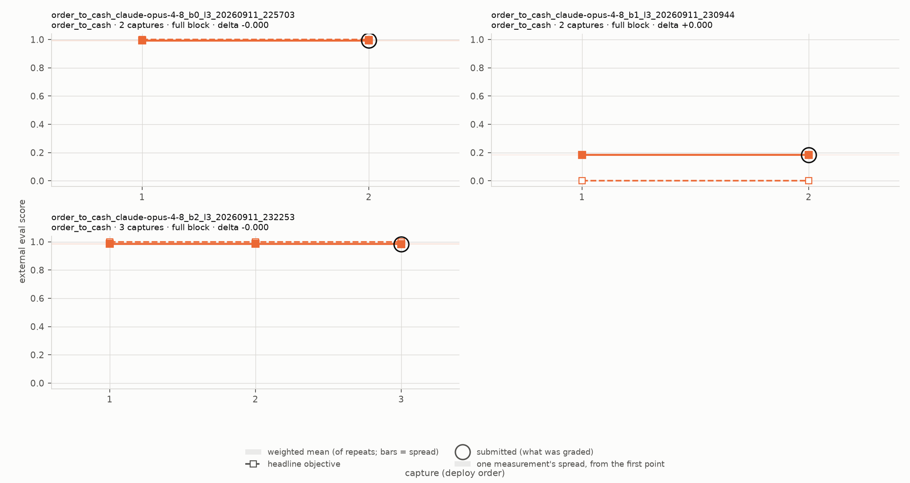

# Does the external eval agree the agent improved?

Each artifact the agent deployed during a session, re-scored against the task's real external eval. One point per deploy, in deploy order. The last point of each is the artifact the run submitted.

*2026-09-16 19:33 UTC · code `d1d6ea4f` · 3 series*

## Results

| run | task | captures | first | last | change | beyond noise? | headline objective | its change |
|---|---|---|---|---|---|---|---|---|
| `order_to_cash_claude-opus-4-8_b0_l3_20260911_225703` | order_to_cash | 2 | 0.992 | 0.992 | -0.000 | no | flag_accuracy | +0.000 |
| `order_to_cash_claude-opus-4-8_b1_l3_20260911_230944` | order_to_cash | 2 | 0.184 | 0.184 | +0.000 | no | flag_accuracy | +0.000 |
| `order_to_cash_claude-opus-4-8_b2_l3_20260911_232253` | order_to_cash | 3 | 0.985 | 0.984 | -0.000 | no | flag_accuracy | +0.000 |

| measure | rose | fell | unchanged | sign test p |
|---|---|---|---|---|
| **weighted mean** | **1** | 2 | 0 | 1.000 |
| **headline objective** | **0** | 0 | 3 | — |

Per-capture numbers are in `checkpoints.csv`.

## What each series shows

- **`order_to_cash_claude-opus-4-8_b0_l3_20260911_225703`** — no change beyond its own measurement noise.
- **`order_to_cash_claude-opus-4-8_b1_l3_20260911_230944`** — no change beyond its own measurement noise.
- **`order_to_cash_claude-opus-4-8_b2_l3_20260911_232253`** — no change beyond its own measurement noise.

## Before quoting these numbers

- **3 of 3 series were scored across more than one code version, or from an uncommitted tree**, so their numbers are not reproducible from a commit: `order_to_cash_claude-opus-4-8_b0_l3_20260911_225703`, `order_to_cash_claude-opus-4-8_b1_l3_20260911_230944`, `order_to_cash_claude-opus-4-8_b2_l3_20260911_232253`.
- **Comparability CHECKED, not assumed** in 3 of 3 series: every scored capture met an identical case set — 60 cases — read back from the per-case reports rather than inferred from the sample settings.
- **Captures are re-scored against today's task code**, so absolute levels may differ from what the original session reported. Within a curve every capture meets the same instrument, which is what makes the points comparable to each other.
- **A rising curve shows the artifact improved. It does not show the agent's internal eval caused it** — that is a separate question this analysis does not address.

## How to read it

- **A capture** is one artifact the agent deployed. **0.000 is a real result** — it would not build, boot, or answer in the required shape — and is drawn hollow.
- **Unmeasurable** captures are OUR failure, not the artifact's. They are counted and named, never scored zero, and carry no point on the curve.
- **Change** is last capture minus first. **Beyond noise?** compares it against twice its own standard error — a screen for whether a change is worth discussing, not a significance test.
- **Two scores per capture.** The *weighted mean* blends every objective the task declares; the *headline objective* is the single one the task owner says the task exists to measure. They can disagree, and when they do the headline is usually the more robust of the two.
- **Repeats.** Each capture is scored more than once where possible; the point is their mean and the error bar their spread. A capture scored once has no bar and no noise floor.

## Left out

`run_dir_missing` 0 · `fetch_failed` 0 · `no_scores` 0 · `mixed_limit` 0 · `mixed_cases` 0 · `no_scorable_captures` 0

A zero means the check ran and matched nothing.
